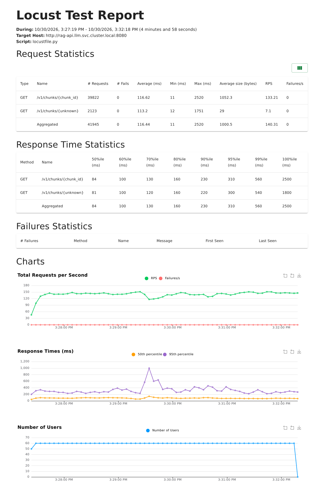
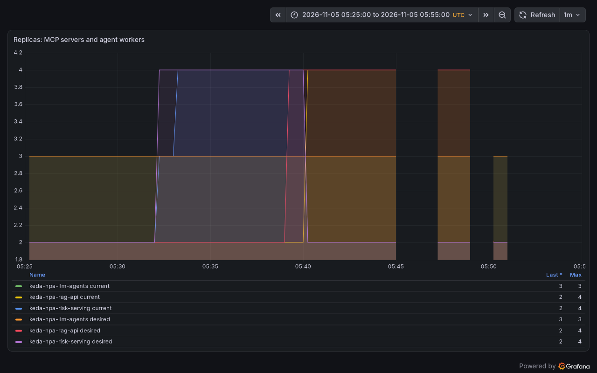
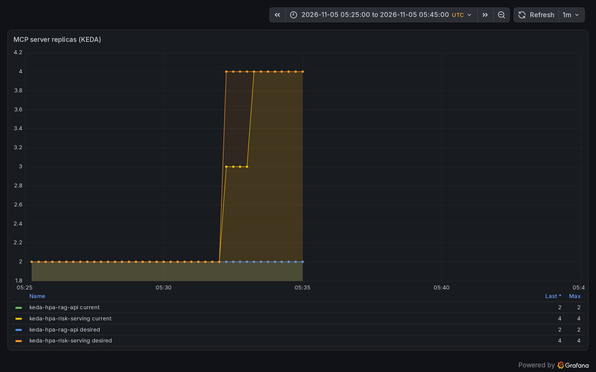
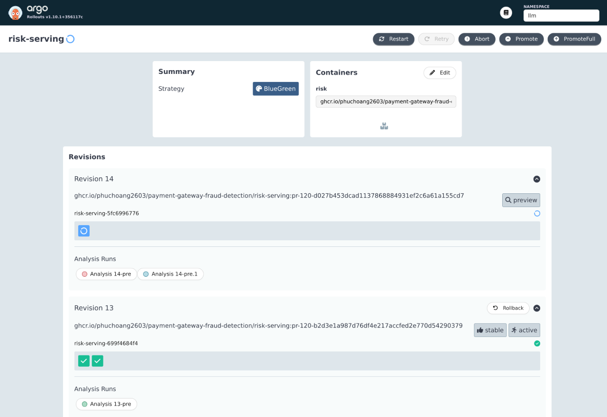
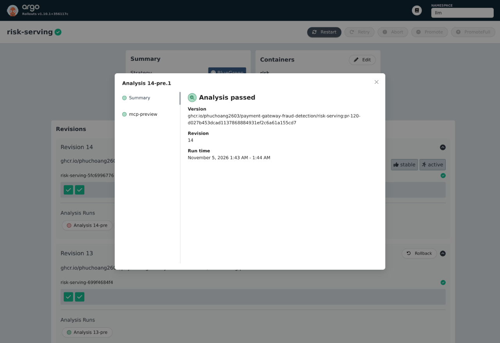

# Autoscaling, load test and releases

Three workloads scale on KEDA and two of them use the same blue-green release strategy in both environments:

| Workload | Range | Metric and target | Evidence |
|---|---|---|---|
| Knowledge API (`rag-api`) | 2 to 4 replicas | Combined REST and MCP request rate, 10 req/s per replica | [Locust run and scale-out](#knowledge-api-rag-api) |
| Risk MCP (`risk-serving`) | 2 to 4 replicas | Tool-call rate, initial 5 calls/s per replica | [Scale-out](#risk-mcp-risk-serving) |
| Agent workers (`llm-agents` WorkerPool) | 2 to 6 workers | Partly or fully booked workers, 0.7 per worker | [Twelve conversations](#agent-worker-pool) |

Model servers are not autoscaled: each environment has one GPU ([Inference](inference.md)). Agent conversations are Substrate actors, created on demand and suspended to zero when idle ([Agents](agents.md#sandbox-warm-start-and-autoscaling)).

## Load test and service level

[`src/llm/rag_serving/loadtest/locustfile.py`](../../src/llm/rag_serving/loadtest/locustfile.py) requests chunks by id (19 of 20 requests real ids, 1 an unknown id that must return 404). It runs in the cluster as an on-demand Job, [`infra/charts/rag-pipeline/loadtest/job.yaml`](../../infra/charts/rag-pipeline/loadtest/job.yaml), against `rag-api` directly as the `llm-benchmark` identity, so it measures the API rather than the gateway's per-client rate limit. The Job asks for 250m CPU and may burst; at 1 CPU it did not schedule on the full dev nodes. Run on 2026-11-05 at 05:36 UTC with 60 users for 5 minutes against 40 chunk ids read through the gateway; the full report is [`loadtest/knowledge-api-locust.html`](loadtest/knowledge-api-locust.html).

```text
Name                       # reqs   # fails |  Avg  Min   Max  Med |  req/s
GET /v1/chunks/{chunk_id}   51738   0 (0%) |   26    4  1463   14 | 172.64
GET /v1/chunks/{unknown}     2715   0 (0%) |   25    5   801   13 |   9.06
Aggregated                  54453   0 (0%) |   26    4  1463   14 | 181.70

Percentiles (ms)   50%  75%  90%  95%  99%  99.9%  100%
Aggregated          14   24   47   86  240   600   1500
```

Service level for the chunk endpoint: p95 at or below 500 ms and no failed requests at 60 users. The run met it, with a p95 of 86 ms, 0 failures in 54,453 requests and 181.7 req/s, while KEDA took `rag-api` from 2 to 4 replicas:



## KEDA scale-out

The "Replicas: MCP servers and agent workers" panel in the LLM agents dashboard (Autoscaling row) shows desired and current replicas for `rag-api`, `risk-serving` and the agent worker pool. The risk run (05:29 to 05:35 UTC on 2026-11-05) and the Locust run (05:36 to 05:42) are on it; the gaps are scrape gaps of the metrics store:



### Knowledge API (`rag-api`)

KEDA scales `rag-api` from 2 to 4 replicas on its combined REST and MCP request rate (`knowledge_api_requests_total` plus `knowledge_mcp_tool_calls_total` in VictoriaMetrics, target 10 req/s per replica); the chart leaves `replicas` to KEDA. During the Locust run:

| Time (UTC) | Metric / target (req/s per replica) | Replicas desired (ready) |
|---|---|---|
| 05:36:16 | 0 / 10 | 2 (2) |
| 05:39:21 | 20.4 / 10 | 4 (2) |
| 05:39:52 | 46.3 / 10 | 4 (4) |
| 05:41:52 | 46.3 / 10 | 4 (4), load finished |

### Risk MCP (`risk-serving`)

Risk's 5 calls/s target is above what one dev client generates, so the target was lowered to 0.5 calls/s per replica for one run and set back to 5 afterwards. A client sent 528 `get_risk_features` calls through the gateway in 300 s at 1.76 calls/s; all returned HTTP 200 and none was rate-limited. The server's own counters record 330 successes and 190 tool failures (`feature store read failed`), all between 05:31 and 05:33 while Feast was being rolled out by the same pull request's dev deploy. KEDA counts calls whatever their outcome, so the scale-out does not depend on them:

| Time (UTC) | Metric / target (calls/s per replica) | Replicas desired (ready) |
|---|---|---|
| 05:30:42 | 0.159 / 0.5 | 2 (2) |
| 05:32:03 | 0.595 / 0.5 | 3 (2) |
| 05:32:24 | 0.446 / 0.5 | 4 (2) |
| 05:33:05 | 0.430 / 0.5 | 4 (3) |
| 05:34:06 | 0.442 / 0.5 | 4 (4) |

Those counter samples account for 520 of the 528 client calls; the remaining eight outcomes were not reconciled. This run demonstrates scaling, not a failure-free service level.

It was back to 2 replicas by 05:43. The panel as it was before the worker pool was added, for this run alone:



 While the new pods started on the full node, two of them failed their liveness probe, which had no startup grace, and were restarted; the chart now gives the pod a startup probe like `rag-api`'s. The 5 calls/s target itself was not reached.

### Agent worker pool

KEDA scales the WorkerPool from 2 to 6 workers on Substrate's own metric, the number of workers that are partly or fully booked (`ate_workerpool_workers{ate_worker_state=~"partial|at_capacity"}`), 0.7 per worker. Argo CD leaves the pool's `replicas` to KEDA.

Twelve conversations sent at once to the two-worker pool (2026-10-31):

| | |
|---|---|
| Workers | 2 → KEDA asked for 3 at 56 s, Ready at 78 s |
| Conversations accepted on the first message | 12 of 12 |
| Time to the full answer | 79 to 123 s, median 112 s (the shared GPU is the limit) |

The 2026-10-31 run has no Grafana capture. On 2026-11-05 the pool again read 667m of its 700m target and asked for a third worker, but that worker (on `dev-server3`) stayed not Ready for 26 minutes: its credential bundle was issued late and its readiness probe timed out. The worker scale-out was not captured on a dashboard.

## Blue-green releases

The knowledge server (`rag-api`, [RAG](rag.md)) and the risk server (`risk-serving`, [Agents](agents.md#risk-agent)) sit behind the agent gateway. Both environments render blue-green Rollouts and KEDA targets their scale subresources. The captures below establish dev behavior only. The active Service keeps its name and a `-preview` Service selects the candidate. A bounded pre-promotion Job with its own identity initializes MCP, lists the tools and makes one call (`rag-api`: a configured knowledge chunk; `risk-serving`: a synthetic scoring call that allows normal missing-history statuses, without requiring a seeded customer). A tool error, missing result or timeout blocks promotion and keeps the active revision serving. The preview starts at one replica and grows to KEDA's desired count before the Service switches; Argo CD leaves replica counts and revision hash selectors to their controllers. `progressDeadlineAbort` aborts a candidate that never becomes ready.

| Release | Pre-promotion analysis | Outcome |
|---|---|---|
| `rag-api` 7fcf4cbc | Successful in 73 s, waiting for a cold pod | Promoted; one Rollout owns every ReplicaSet and no Deployment remains |
| `risk-serving` 756dbb8686 | Successful | Promoted |
| `rag-api` 69f45b78c4, faulty: `RAG_DB_HOST` points at a missing database | None: the preview pod failed readiness with 503 for more than 5 min | Never promoted; the active Service kept selecting 7fcf4cbc. The Rollout stayed `Progressing` until the spec was restored, which is why `progressDeadlineAbort` is set |
| `risk-serving` 5dcd89f99f, faulty: `MODEL_URL` points at a model server that does not exist | Failed in 27 s: `preview returned an MCP tool error` | Rollout aborted; the active Service kept selecting 756dbb8686, and the gateway scored 0.1967 during the rollout and after it |

Each faulty candidate was made by pausing Argo CD's reconcile of the app with the `argocd.argoproj.io/skip-reconcile` annotation, patching one environment variable on the Rollout, and restoring it afterwards; both Rollouts returned to Healthy on their original revisions. Argo Rollouts skips the analysis on a first install, which has no previous revision to protect; that case was not run.

On 2026-11-05 at 06:43 UTC, risk revision 14 (`5fc6996776`) retried its failed analysis while revision 13 (`699f4684f4`) retained two Ready active pods:



The retry `risk-serving-5fc6996776-14-pre.1` passed, and revision 14 became active with two Ready pods at 06:44 UTC:



Cleanup verification on 2026-11-05: risk revision 15 (`664d9f6f46`) passed `risk-serving-664d9f6f46-15-pre` in 45 s; knowledge revision 14 (`65c7648dd6`) passed `rag-api-65c7648dd6-14-pre.2` in 64 s after earlier connection timeouts. Both finished Healthy with two Ready pods. Dev Feast was Ready with container-local probes and no probe-IP NetworkPolicy after replacing its restarting pod; the loopback health request returned 200 in 104 ms. Production Feast rendered identically to the pre-cleanup version.

Both environment configurations now use the same scoring gate and native Feast HTTP probes. The gate uses synthetic identifiers and accepts normal missing history, while requiring request features and a valid model response. On 2026-11-05, the dev release from `85307f1` passed `rag-api-6b9d78dc-18-pre` in 53 s and `risk-serving-86c9c7557-19-pre` in 51 s; both Rollouts became Healthy with two available replicas. Feast pod `feast-server-679dfb785f-ccv4f` was Ready with native HTTP startup, readiness and liveness probes and zero restarts, without a platform change or source-IP exception. All 36 CI checks passed. Production deployment and adoption remain unverified.
