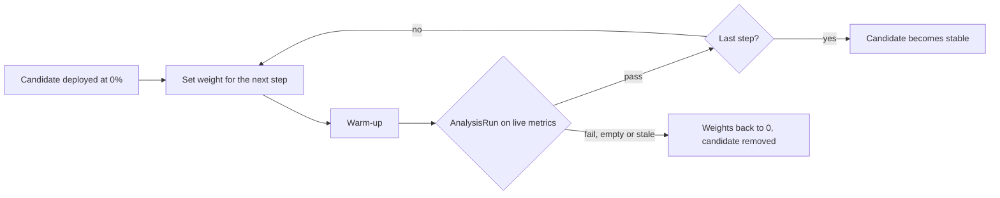
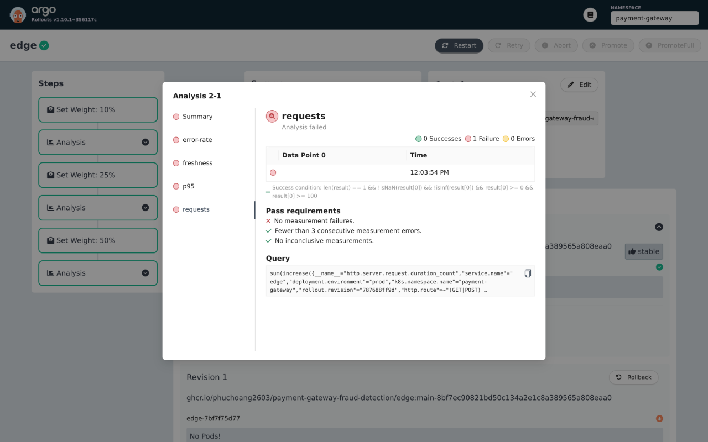
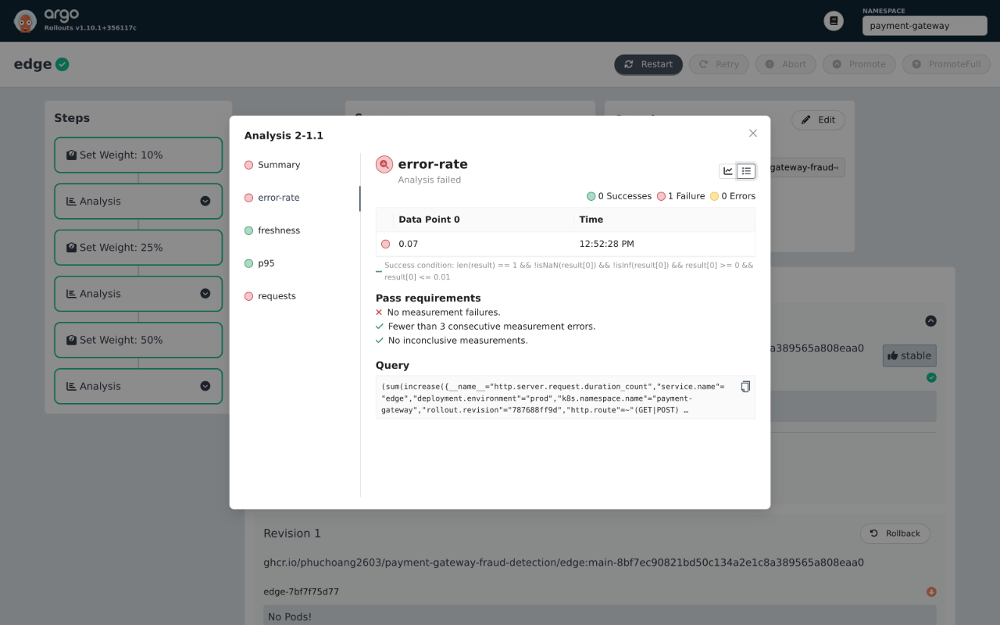
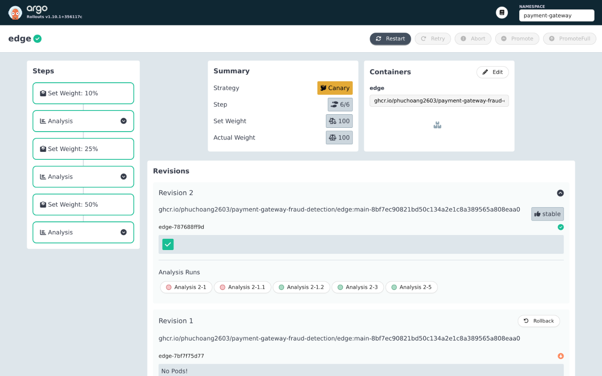
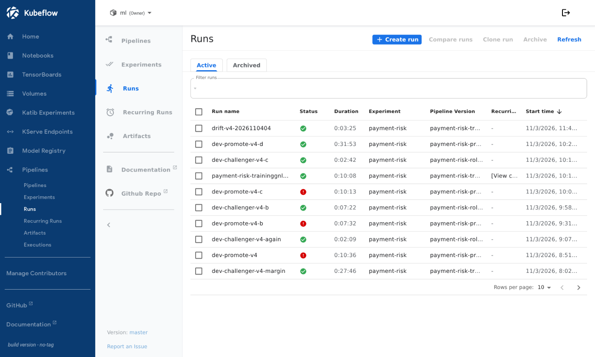
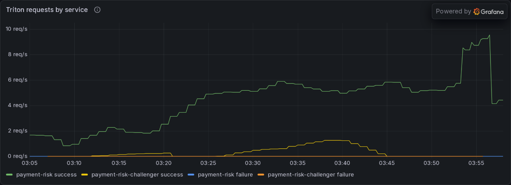
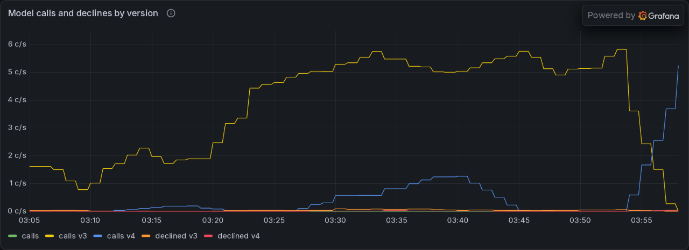

# Analysis-gated promotion (novel)

A new release never replaces the old one on trust. Both the public checkout service and the fraud model move traffic to a candidate in small steps, and each step waits for an Argo Rollouts `AnalysisRun` that queries live metrics from VictoriaMetrics. A failed or empty measurement returns all traffic to the current version and removes the candidate; only passing measurements promote it. Too little traffic fails the analysis rather than passing it.

| | Edge checkout canary | Model challenger |
|---|---|---|
| Traffic split | Gateway API route weights, set by the Rollouts plugin | Istio waypoint route weights, set by the `payment-risk-promote` pipeline |
| Steps | 10%, 25%, 50% | Bounded steps up to 20% |
| Analysis | Request count, 5xx fraction, p95, sample age | Request count, failure rate, queue plus compute time against the champion, decline share against the champion |
| Proof | Prod, 2026-11-03: a faulty build rejected, the healthy retry promoted | Dev, 2026-11-04: two runs aborted, the third promoted v4 |

## Edge checkout canary

Only Edge uses a canary; the other five Go services remain Deployments. Rollouts controls the public route's `edge`/`edge-canary` weights and Service hash selectors; Argo CD ignores those controller-owned fields. Internal callers use stable `edge`; only public `/checkout/` traffic is split.

The platform supplies Rollouts v1.10.1 and Gateway API plugin v0.17.0. The application owns the [Rollout and analysis templates](../../infra/charts/payment-gateway/templates/rollout.yaml). Dev receives configuration only and sets `rollout.analysis.enabled: false`, since it has no public checkout traffic to measure; acceptance runs directly against prod.

Subsequent candidates receive 10%, 25%, then 50% of public checkout traffic. Each step warms up for five minutes and requires two passing observations, one minute apart: at least 100 candidate checkout requests in five minutes, 5xx fraction at most 1%, p95 at most one second and latest sample age at most 120 seconds. Queries select environment, namespace and Rollout pod hash; business declines do not count as 5xx. Empty, stale, non-finite or insufficient observations abort after warm-up; three consecutive query errors abort. The rollout's progress deadline is 30 minutes. Low traffic cannot silently promote.

For an incident, run `kubectl --kubeconfig ~/.kube/talos-prod.yaml argo rollouts abort edge -n payment-gateway` when the kubectl plugin is installed, then revert the source image/chart and publish through the existing release flow. Confirm stable endpoints and HTTPRoute weights before considering recovery complete. Abort does not undo database migrations or changes to other services.

Prod acceptance on 2026-11-03 verified abort to stable/canary weights 100/0, reconciliation without weight reset, and automatic promotion after two passing observations at each stage. The rollout failure alert fired on abort and resolved on retry.

Browser captures from the retained prod AnalysisRuns below show the failed attempts and healthy retry. The Rollouts UI displays UTC−05:00; all captures are from 2026-11-03.

With no candidate traffic, Analysis 2-1 failed after warm-up. The blank measurement is an empty query result, not zero requests.

The fault attempt, Analysis 2-1.1, failed the 1% error threshold: the UI rounds the stored 0.0721649 fraction to 0.07. Its request guard also failed (97 against a minimum of 100); freshness and p95 passed.

On the healthy retry, final-stage Analysis 2-5 passed all four guards. Its two request observations were 1,703 and 1,832.

All three stages completed, promoting revision `787688ff9d` to stable at 100% traffic.

## Model challenger

A gate-passed version can run as a challenger next to the champion, and traffic moves to it in bounded steps that an analysis must approve.

- **Challenger service.** `roll_out` with `role=challenger` serves the version as the InferenceService `payment-risk-challenger` on the same runtime, GPU claim and KEDA scaling, and the registry marks it `challenger`.
- **Split.** An Istio waypoint in `ml` and a Gateway API route split the champion's Service between the two services, 100/0 until the `payment-risk-promote` pipeline changes the weights. Only that pipeline changes them, never above 20 percent, and Argo CD ignores them as it does for Edge. The split is random per request, and `roll_out` labels the champion Service for the waypoint.
- **Analysis.** Each step runs an Argo Rollouts `AnalysisRun` built from the `payment-risk-challenger` template, over a 10 minute window on the chart's values and 5 minutes on dev. It needs a minimum number of challenger requests, a failure rate of at most 1%, a queue plus compute time per request of at most twice the champion's, and a decline share within 2 percentage points of the champion's (a ratio of two shares near 0.3% is noise at these volumes).
- **Outcome.** A failed analysis returns the weights to 0, deletes the challenger and archives its version. After the last step the challenger is deleted, then the champion service is updated to its version and probed, so the single GPU node never holds three model servers; a failed probe redeploys the old version.
- **Scoring.** Go Fraud scores each answer under the layout and threshold of the version that produced it, and `fraud.model.calls` carries `model_version` and `declined`.

On dev, v4 (the same data and settings as v3, registered by a manual run with a lowered `gate_margin`, so the two score identically) ran as the challenger next to v3 under about 4 payments per second from the live simulator. Three `payment-risk-promote` runs, in order:

| Run | Steps | Result |
|---|---|---|
| `dev-promote-v4-b` | 10, 20 | Aborted at 10%: the decline ratio was 3.7 on 1 decline in 94 calls. Weights back to 0, challenger deleted, v4 archived. The check became the difference in decline share |
| `dev-promote-v4-c` | 10, 20 | Aborted at 10%: 46 to 57 challenger requests against a minimum of 50, because the simulator then sent 1.7 payments per second. Same cleanup |
| `dev-promote-v4-d` | 10, 20 | Both steps passed and v4 replaced v3 as production; v3 is `archived` |

| Step | Challenger calls | Decline share, challenger / champion | Queue plus compute per request, challenger / champion |
|---|---:|---|---|
| 10% | 171 of 1,834 | 1.17% / 1.20% | 381 µs / 376 µs |
| 20% | 370 of 1,873 | 1.08% / 1.00% | 416 µs / 418 µs |

The Kubeflow runs page lists the three promotion runs: `dev-promote-v4-b` and `dev-promote-v4-c` failed (aborted by the analysis) and `dev-promote-v4-d` succeeded in 31 min 53 s.

Between the runs, the swap itself found a limit: with the challenger, the old champion and the new champion's surge pod on the one GPU node, the new pod sat Pending on CPU for 11 minutes until the challenger was deleted by hand, which is why the step now deletes it first. The Service kept its waypoint label through the swap, and the KEDA scaler stayed in place.

## Tried and dropped

Tried and dropped on dev, 2026-11-03: KServe's Knative canary (Knative Serving 1.23.0 and 1.24.0 reject DRA `resourceClaims`) and its InferenceGraph (the router discards response headers, so binary answers fail). A waypoint route split 400 binary requests 309 to 91 at 80/20, at +2.4 ms median and +9.8 ms p99.

## Limits

- The Edge canary needs public checkout traffic, so its recorded acceptance is from prod, before prod was retired.
- The model challenger's waypoint route is verified on dev only; no waypoint was created on prod.
