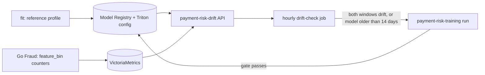

# Drift

**Status: done on dev; thresholds not yet calibrated.** Drift is the only automatic trigger of retraining, with an age ceiling as backstop. No labels are needed: the signal is the scored requests' feature distribution against the training split of the serving version. Code: [`src/ml/risk_model`](../../src/ml/risk_model) (`drift.py`, `drift_service.py`, `drift_check.py`); chart: [`templates/drift.yaml`](../../infra/charts/ml-training/templates/drift.yaml).

## Signal

- **Reference profile.** The `fit` step computes, from the training split, weighted decile edges and the share of rows per bin (missing values in a last bin) for every feature. `record_version` stores it on the registry version (`reference`) and packages the edges and the decline threshold into the served model's Triton config.
- **Live counts.** Go Fraud reads the edges of the version that scored a request and increments `fraud.model.feature_bin{feature,bin,model_version}` for each feature. There is no sampling and no extra call; the per-request cost is not yet measured.
- **Drift API.** `payment-risk-drift` (FastAPI, own image, KEDA-scaled on its request count) reads the serving version from the registry and the counts from VictoriaMetrics. `GET /v1/drift?window=6h` returns the population stability index (PSI) per feature and a state: `insufficient` below the minimum sample, `drifting` when 3 features reach PSI 0.2 or a top-5 feature by gain reaches 0.25, else `ok`. `/metrics` exports the 24 h state and PSI for the Grafana ML dashboard. The answers are pydantic models ([`drift_schemas.py`](../../src/ml/risk_model/drift_schemas.py)) returned as `response_model`s, and `window` is a validated query parameter (a positive count and `m`, `h` or `d`, otherwise a 422 before any read). `/healthz` and `/readyz` are the probes.

## Trigger

The hourly `payment-risk-drift-check` job reads the 6 h and 24 h states and starts one `payment-risk-training` run through the Kubeflow API when both drift, or when the serving version was registered more than 14 days ago. A `drift-` run in progress, a 24 h cooldown, 3 runs in 7 days and a serving version under 2 days old each stop it. The run takes the normal path: `plan_windows` stops it when there is no newer history, and the gate decides whether the retrained model replaces production ([pipeline](pipeline.md)).

## Proof on dev

v4 carries a reference profile of 50 features, so it was the first version the drift API could judge. The live simulator sent about 4 payments per second through Go Fraud for 45 minutes, with its `drift` step (`foreign_ip_probability` 0.25, `amount_scale` 1.8) switched on after the first 10.

**Counters and API.** `fraud.model.feature_bin` reached VictoriaMetrics for v4: 936 requests counted by 03:54, 6,886 in the 6 h window at 04:14 and 14,729 when the check ran at 04:42. `/v1/drift` answered for 10 min, 6 h and 24 h windows, and the Grafana ML dashboard shows the per-feature PSI and the drift state.

**The dev baseline is already drifting.** Before the injected step both windows read `drifting`, with 43 of 50 features over their threshold, because the live traffic differs from the replayed history the model trained on. The largest PSIs are `scored_hour_utc` (7.3; a 6 h window covers a quarter of the day, so any time-of-day feature breaches), `merchant_account_age_days` (4.3) and the 1 h and 24 h stream attempt counts (1.2 to 2.5; the live rate is not the replay's). A feature the reference never saw missing also breaches on a small share: 21 of 936 requests (2.2%) arrived without `item_count`, which the 0.0001 floor turns into a PSI of 0.12. The thresholds are therefore not calibrated for dev, and a clean `ok` to `drifting` transition is not shown. On prod, where training and serving see the same stream, the state would be the thing to calibrate first.

**The injected shift is visible.** On the 10 minute window `amount_minor` rose from a PSI of 0.116 before the step to 0.468 eleven minutes after it. The 6 hour window dilutes it (0.131 to 0.111), which is why the rule needs the short window to see a recent shift. The `foreign_ip_probability` part of the step did not move `ip_shipping_country_mismatch` (0.001 afterwards).

**The check and the trigger.** The first hourly checks on dev failed: the Kubeflow run listing rejected the `+00:00` timestamp the check sent (HTTP 400), so no drift check had worked before this run. After the fix:

| Check | Policy | Outcome |
|---|---|---|
| As deployed | `min_age_days` 2 | `drifting` in both windows, no run: `young`, because v4 was registered three hours earlier |
| Same job with `min_age_days` 0 (dev-only override, to reach the trigger) | | Started `drift-v4-2026110404` (reason `drift`, 43 features over 14,729 requests) |
| Same job again | | No second run: `active` |

The started run finished in 3 min 25 s. `plan_windows` stopped it because v4's cutoff, 2026-10-28, is already the newest replayed day, so no training set was built, nothing was registered and v4 stayed production. This is the designed cost of a check that fires without new data: one small pod. The recurring run that an earlier version of this change created on dev (daily at 03:17 UTC) was still enabled and had fired the same way that morning; it was deleted, so the drift check is the only trigger.

**The gate on a drift-started run.** To see the retraining path through the gate, a second run used the drift trigger with `force=true` on v4's training-set snapshot and windows (the drift check passes neither, since it relies on new replayed days). It built the model, scored it on the GPU and ran the normal gate in 17 min 26 s: test PR-AUC 0.9370 against production v4's 0.9370, which is under the 0.005 margin, so the gate failed (`test PR-AUC 0.9370 is under production 0.9370 plus the 0.005 margin`) and `record_version` and `roll_out` were skipped. The same data and settings give the same model, so a retrain without new data does not replace production; the registry still holds v4 as the only production version.

**Cost of the counters.** A Go benchmark ([`count_bench_test.go`](../../src/payment-gateway/fraud/internal/adapters/kserve/count_bench_test.go)) counts one request of 50 features, 10 bins each, through the OpenTelemetry SDK counter: 25 µs, 50 allocations and 802 bytes per request (the run-to-run range is 25 to 28 µs). Without a profile the path costs 7 to 10 ns. Against a model call of about 1.2 ms median (loopback, [serving](serving.md#model-service)) and a feature read of 60 to 116 ms, the counters add under 2% to the model call. The benchmark does not include the exporter, which batches.

Not shown: a drift-started run on newer replayed days that passes the gate, and a clean `ok` state on dev (the baseline above is already drifting).
