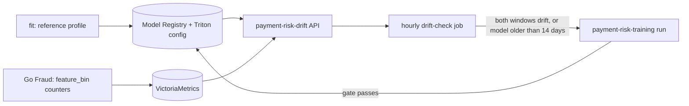

# Drift

**Status: written, unit-tested in CI, dev proof running.** Drift is the only automatic trigger of retraining, with an age ceiling as backstop. No labels are needed: the signal is the scored requests' feature distribution against the training split of the serving version. Code: [`src/ml/risk_model`](../../src/ml/risk_model) (`drift.py`, `drift_service.py`, `drift_check.py`); chart: [`templates/drift.yaml`](../../infra/charts/ml-training/templates/drift.yaml).

## Signal

- **Reference profile.** The `fit` step computes, from the training split, weighted decile edges and the share of rows per bin (missing values in a last bin) for every feature. `record_version` stores it on the registry version (`reference`) and packages the edges and the decline threshold into the served model's Triton config.
- **Live counts.** Go Fraud reads the edges of the version that scored a request and increments `fraud.model.feature_bin{feature,bin,model_version}` for each feature. There is no sampling and no extra call; the per-request cost is not yet measured.
- **Drift API.** `payment-risk-drift` (FastAPI, own image, KEDA-scaled on its request count) reads the serving version from the registry and the counts from VictoriaMetrics. `GET /v1/drift?window=6h` returns the population stability index (PSI) per feature and a state: `insufficient` below the minimum sample, `drifting` when 3 features reach PSI 0.2 or a top-5 feature by gain reaches 0.25, else `ok`. `/metrics` exports the 24 h state and PSI for the Grafana ML dashboard.

## Trigger

The hourly `payment-risk-drift-check` job reads the 6 h and 24 h states and starts one `payment-risk-training` run through the Kubeflow API when both drift, or when the serving version was registered more than 14 days ago. A `drift-` run in progress, a 24 h cooldown, 3 runs in 7 days and a serving version under 2 days old each stop it. The run takes the normal path: `plan_windows` stops it when there is no newer history, and the gate decides whether the retrained model replaces production ([pipeline](pipeline.md)).

## Proof on dev

Written but not yet run: the counters in VictoriaMetrics, the drift state under injected drift, one triggered run and no second, the gate outcome, the per-request cost of the counters and a Locust run of the API. The live simulator takes `drift` steps (`foreign_ip_probability`, `familiar_context_probability`, `amount_scale` from an offset in the run) to inject the shift.
