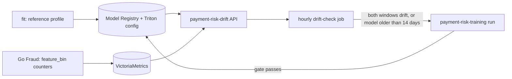
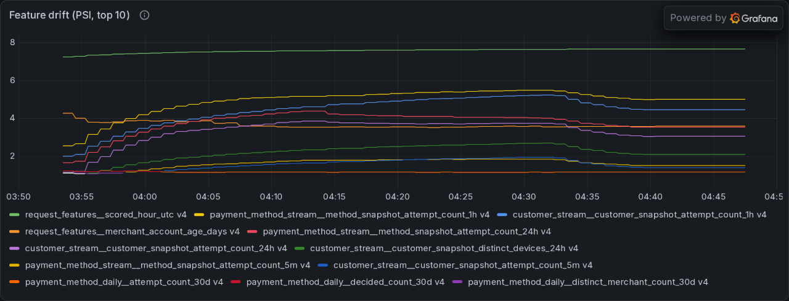
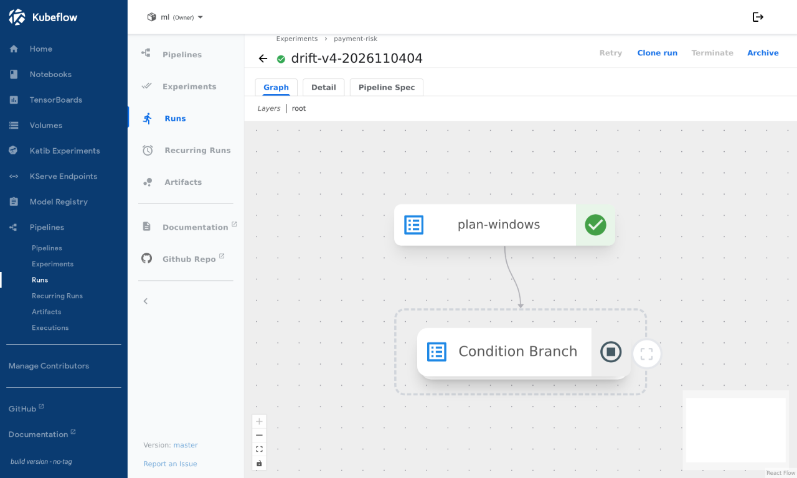
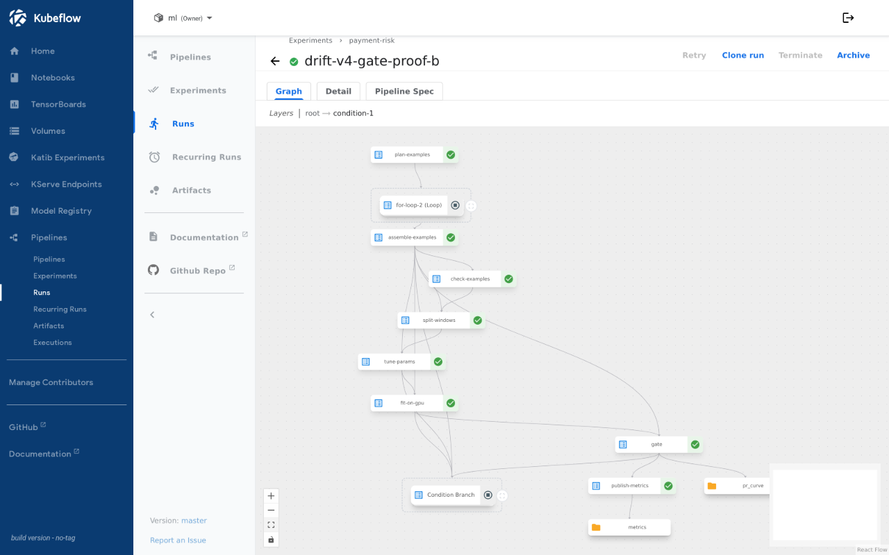

# Drift

**Status: done on dev; thresholds not yet calibrated.** Drift is the only automatic trigger of retraining, with an age ceiling as backstop. No labels are needed: the signal is the scored requests' feature distribution against the training split of the serving version. Code: [`src/ml/risk_model`](../../src/ml/risk_model) (`drift.py`, `drift_service.py`, `drift_check.py`); chart: [`templates/drift.yaml`](../../infra/charts/ml-training/templates/drift.yaml).

## Signal

- **Reference profile.** The `fit` step computes, from the training split, weighted decile edges and the share of rows per bin (missing values in a last bin) for every feature. `record_version` stores it on the registry version (`reference`) and packages the edges and the decline threshold into the served model's Triton config.
- **Live counts.** Go Fraud reads the edges of the version that scored a request and increments `fraud.model.feature_bin{feature,bin,model_version}` for each feature. No sampling or extra service call is required.
- **Drift API.** `payment-risk-drift` (FastAPI, own image, KEDA-scaled on its request count) reads the serving version from the registry and the counts from VictoriaMetrics. `GET /v1/drift?window=6h` returns the population stability index (PSI) per feature and a state: `insufficient` below the minimum sample, `drifting` when 3 features reach PSI 0.2 or a top-5 feature by gain reaches 0.25, else `ok`. `/metrics` exports the 24 h state and PSI for the Grafana ML dashboard. The answers are pydantic models ([`drift_schemas.py`](../../src/ml/risk_model/drift_schemas.py)) returned as `response_model`s, and `window` is a validated query parameter (a positive count and `m`, `h` or `d`, otherwise a 422 before any read). `/healthz` and `/readyz` are the probes.

v4 carries a reference profile of 50 features, so it was the first version the drift API could judge. The live simulator sent about 4 payments per second through Go Fraud for 45 minutes, with its `drift` step (`foreign_ip_probability` 0.25, `amount_scale` 1.8) switched on after the first 10.

**Counters and API.** `fraud.model.feature_bin` reached VictoriaMetrics for v4: 936 requests counted by 03:54, 6,886 in the 6 h window at 04:14 and 14,729 when the check ran at 04:42. `/v1/drift` answered for 10 min, 6 h and 24 h windows, and the Grafana ML dashboard shows the per-feature PSI and the drift state.

Before injection, both dev windows already read `drifting`: 43 of 50 features exceeded thresholds because live traffic differed from replayed training history. The largest PSIs were scoring hour (7.3), merchant age (4.3) and stream counts (1.2–2.5); dev thresholds remain uncalibrated.

**The injected shift is visible.** On the 10 minute window `amount_minor` rose from a PSI of 0.116 before the step to 0.468 eleven minutes after it. The 6 hour window dilutes it (0.131 to 0.111), which is why the rule needs the short window to see a recent shift. The `foreign_ip_probability` part of the step did not move `ip_shipping_country_mismatch` (0.001 afterwards).

Counter overhead ([benchmark](../../src/payment-gateway/fraud/internal/adapters/kserve/count_bench_test.go)): 25–28 µs, 50 allocations and 802 bytes per request for 50 features through the OpenTelemetry SDK, excluding the batched exporter.

## Trigger

The hourly `payment-risk-drift-check` job reads the 6 h and 24 h states and starts one `payment-risk-training` run through the Kubeflow API when both drift, or when the serving version was registered more than 14 days ago. A `drift-` run in progress, a 24 h cooldown, 3 runs in 7 days and a serving version under 2 days old each stop it. The run takes the normal path: `plan_windows` stops it when there is no newer history, and the gate decides whether the retrained model replaces production ([pipeline](pipeline.md)).

Dev trigger results:

| Check | Policy | Outcome |
|---|---|---|
| As deployed | `min_age_days` 2 | `drifting` in both windows, no run: `young`, because v4 was registered three hours earlier |
| Same job with `min_age_days` 0 (dev-only override, to reach the trigger) | | Started `drift-v4-2026110404` (reason `drift`, 43 features over 14,729 requests) |
| Same job again | | No second run: `active` |

The run finished in 3 min 25 s: `plan_windows` found no newer history than v4's 2026-10-28 cutoff and skipped training.

With `force=true` on the same training snapshot, `drift-v4-gate-proof-b` ran through GPU fitting and scoring in 17 min 26 s. Test PR-AUC matched production at 0.9370, below the required +0.005 margin, so registration and rollout were skipped.

