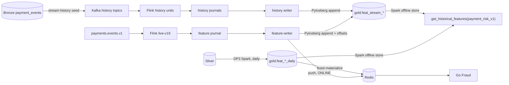

# Feature store

Feast holds the fraud features in two stores: an online store (Redis) for decision-time lookups by Go Fraud, and an offline store for point-in-time training data. The daily and streaming definitions govern both paths. Code: [`src/data-pipeline/feast`](../../src/data-pipeline/feast); definition: [`contracts/features`](../../contracts/features).

Each feature has one engine: Spark computes the daily 7- and 30-day windows, and Flink computes the 5-minute, 1-hour and 24-hour windows for both live traffic and history.

## Features

Keys are integration-scoped customer and payment-method identities. Request features come from the attempt itself; history features count earlier attempts in `[t − window, t)` with explicit coverage, so missing or stale history is null, never zero.

| Group | Features | Computed by | Status |
|---|---|---|---|
| Request | amount, customer and merchant account ages, nullable IP/shipping mismatch, item count, device presence, amount relative to the customer and payment-method 30-day averages, UTC hour of scoring | Feast pure Python request_features on-demand view | Shared by training and serving |
| Short history | customer and method attempt counts over 5 minutes, 1 hour and 24 hours; distinct customer devices over 24 hours | Flink | Flink writes the v2 journal; the feature writer writes Redis and the offline stream tables |
| Long history | 7- and 30-day attempt, amount, decided, declined and distinct counts and decline rates per customer and payment method, at daily anchors | DP3 Spark over Silver into `gold.feat_customer_daily` and `gold.feat_payment_method_daily` ([`fraud-history-batch-v1`](../../contracts/features/fraud-history-batch-v1.yaml)); Feast materialization | Implemented; cluster evidence pending |

Labels, scenario and oracle fields, and anything that happens after the attempt (decision, outcome, payment status) are never features.

## Build order

Steps 2–8 are implemented; prod runs are pending.

1. **DP3 offline features.** A daily Spark job over Silver writes `feat_customer_daily` and `feat_payment_method_daily` with `event_timestamp` and `created`, for the 7- and 30-day windows.
2. **Offline store.** Feast's Spark offline store reads the `feat_` tables through `SparkSource(table=…)` on the Iceberg catalog. Training builds its dataset with `get_historical_features(payment_risk_v1)` from `label_attempt`.
3. **Streaming features to offline.** The `feature-writer` appends journal snapshots to `gold.feat_stream_*` with PyIceberg, keeping the Kafka offsets in the same commit. History comes from a Kappa replay of Bronze through the same Flink job.
4. **Streaming features to online.** The same process pushes each batch to Redis with Feast's `push` before buffering its Iceberg append.
5. **Materialization.** `feast-materialize` loads the daily views into Redis after DP3 and checks a sample against the offline rows.
6. **TTL and feature services.** 31 days 12 hours for daily views and 24 hours 5 minutes for stream views, with reasons on the [TTL](#ttl-and-freshness) section; one `payment_risk_v1` service for training and Go Fraud.
7. **Natural keys.** Views key on integration plus customer or payment-method IDs, and Go Fraud requests the new service.
8. **Governance.** OpenMetadata's Flink connector records the live job, with SDK lineage as the fallback; the writer, history and materialization publish lineage and run status.

## Online and offline paths

- **Online:** the Flink journal feeds one `feature-writer` that pushes Redis before buffering its Iceberg appends. `payment_risk_v1` exposes customer and payment-method daily and stream views under natural keys, plus request_features from raw fields in the same request. Go rules retain their own logic.
- **Offline:** a training row uses plain `started_at` and takes the latest daily anchor at or before that timestamp, including an anchor at exactly that instant. The writer maps stream rows to `event_timestamp = online_write_at + 1µs`, so a snapshot written at the scored attempt's start is invisible then. The remaining skew is the DP3 delay after midnight. Long windows are batch-only; Flink keeps only the short windows, with no HybridSource bootstrap.
- **Materialization:** `feast-materialize` runs local Spark in one Argo container, loading from each registry last end minus lookback plus one day through now (first run: now minus TTL). Use `since=<backfill start>` after a backfill; end is always now. The check samples newest keys only. If DP3 deletes every row of an entity, its prior online value remains until TTL.

`fraud_feast.training.entity_rows(spark, start, end, cutoff)` joins lifecycle-valid Silver attempts and their attempt_started request context to `label_attempt` rows with `label_source = LABEL_SOURCE_SIMULATION_TRUTH` and `label_available_at <= cutoff`, and their `label` as its target. Retrieval requests `payment_risk_v1` with `full_feature_names=True`. Time-ordered splits need no label-maturity gaps. The initial history replay uses `start=2026-07-29`, `end=2026-10-29` (exclusive); the workflow adds the one-day lead-in.

The training image installs `fraud_feast[spark]` and runs `python -m fraud_feast.spark_jars <spark-jars-directory>` during its build to use the same pinned, checksum-verified JARs as `data-platform-spark`. Set `SPARK_MASTER=local[*]` for retrieval in one Kubeflow Pipelines step, with local disk for Spark spill. Local Spark is also the default for materialization. No Feast SparkApplications are created.

History splits the range into 7-day units and runs up to `historyParallelism` of them at once (4 in prod). Each unit runs as `history-v19-<YYYYMMDD>` with its own topics, Flink deployment, transactional IDs and consumer group, because one logical-clock job needs a single ordered input partition and cannot itself run in parallel. Each unit adds a one-day lead-in so its 24-hour windows and dedup horizon are complete, which makes units independent. The seed sorts the unit's Bronze rows with DuckDB, writes them with one bootstrap clock control before and one final control after, and the barrier releases inputs as soon as the bootstrap arrives. Bounded Flink then runs to FINISHED, and the writer reads the journal from zero to committed EOF. It deletes each table’s epoch and unit range in a short commit, then writes buffered rows without lead-in through the same writer and conflict retries as live mode. A unit is partially visible while running or after failure; nothing trains until the entire replay passes its gates. A failed unit restarts from the range delete; live recovery instead uses Iceberg offset properties. The gate requires zero decode rejects, a completed seed and a FINISHED job; duplicates and too-late rejects are reported only. `fraud_feast.materialize --stream-recovery` rebuilds stream Redis from the last STREAM_TTL of batch rows.

**Why Kappa and not a batch implementation.** A second, Spark implementation of the short windows would have to be proved equal to Flink's and kept equal. Replaying history through the same Flink job means training and serving share one implementation, at the cost of replay time.

## Entities, views and service

| Object | Definition |
|---|---|
| Entities | `integration` (`integration_id`), `customer` (`customer_id`), `payment_method` (`payment_method_fingerprint`); Feast allows one join key per entity, so each view uses `integration` plus one natural key |
| Daily views | `customer_daily`, `payment_method_daily`: `SparkSource(table="lake.gold.feat_*_daily")` |
| Stream views | `customer_stream`, `payment_method_stream`: a `PushSource` for online writes over `lake.gold.feat_stream_*`, filtered to the configured epochs; each carries `epoch`, which is not a model input |
| Request view | `request_features`, a pure Python on-demand view over the request and the two daily views' 30-day amount and count |
| Service | `payment_risk_v1`: the daily and stream features and `request_features`, used by training and Go Fraud |

Arrow is on for every transfer into Python: the Spark offline store sets `spark.sql.execution.arrow.pyspark.enabled`, training reads `get_historical_features(...).to_arrow()`, and the writer appends Arrow tables. Offline retrieval needs no Redis: `fraud_feast.runtime.store(redis=False)` builds the store without an online store.

## TTL and freshness

| View | TTL | Reason |
|---|---|---|
| Daily | 31 days 12 hours | The longest window is 30 days and a non-zero state always has a row within it plus one anchor day. 12 hours covers `dp-daily` and the materialization after it. Only an all-zero dormant row expires. |
| Stream | 24 hours 5 minutes | The longest window is 24 hours, and Flink emits a snapshot on every expiry, so a non-zero state always has a recent row. 5 minutes bounds the journal-to-Redis delay. |

Feast applies TTLs offline, and Go Fraud applies the same TTLs at its server decision time, recorded as `EvaluatedAt`, with independent evidence for each view. Go also nulls a relative-amount feature when its daily view is not available, because Feast's online read would still compute it from an expired row.

## Train/serve consistency

| Rule | Enforcement |
|---|---|
| **Exclude the scored attempt.** Training joins at `started_at`. Stream rows use `online_write_at + 1µs`, so a snapshot including that attempt is invisible at its own start. Daily rows are anchored at the midnight closing their window; both paths see only closed days. Redis receives those same rows after materialization, so it can lag the latest daily anchor. | [Training timestamp](../../src/data-pipeline/feast/fraud_feast/training.py), [stream mapper](../../src/data-pipeline/feast/fraud_feast/stream_writer.py), [daily anchors](../../src/data-pipeline/batch/batch/gold/windows.py) and [materialization](../../src/data-pipeline/feast/fraud_feast/materialize.py). |
| **Apply the same TTL.** At scoring time `t`, a value older than `t − ttl` is unknown. Feast applies the view TTL offline; Go applies it online using its server clock because Feast's online read ignores TTL. Flink emits snapshots on window expiry, so the stored counts already exclude expired contributions. | [View TTLs](../../src/data-pipeline/feast/fraud_feast/repo.py), [server clock](../../src/payment-gateway/fraud/internal/application/assessment.go), [online freshness checks](../../src/payment-gateway/fraud/internal/adapters/feast/client.go) and [Flink expiry timers](../../src/data-pipeline/streaming/fraud_streaming/operators.py). |
| **Use one engine per feature.** Spark computes daily 7/30-day features; Flink computes 5m/1h/24h windows. Stream history is a Kappa replay of the same Flink job, so training and serving share the stream implementation. | [Daily features](../../src/data-pipeline/batch/batch/gold/features.py), [stream windows](../../src/data-pipeline/streaming/fraud_streaming/model.py) and [history workflow](../../infra/charts/data-pipelines/templates/stream-history.yaml). |
| **Use one feature list.** Training retrieves `payment_risk_v1`, and Go Fraud requests that service. Different model inputs require a new service version. | [Service definition](../../src/data-pipeline/feast/fraud_feast/repo.py), [historical/server retrieval check](../../src/data-pipeline/feast/tests/test_repo.py) and [Go request](../../src/payment-gateway/fraud/internal/adapters/feast/client.go). |
