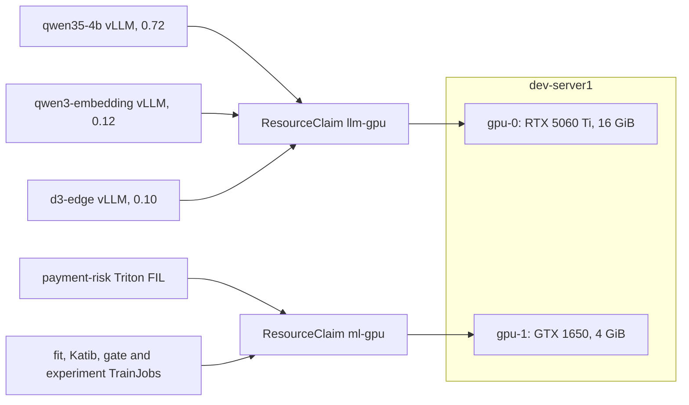

# NVIDIA DRA GPU sharing (novel)

Kubernetes' classic `nvidia.com/gpu: 1` gives a whole card to one pod, so a model server and a training job could never share a GPU, and two cards on one node cannot be told apart. The platform runs the NVIDIA DRA driver instead (Dynamic Resource Allocation): a `ResourceClaim` picks one device by its attributes, and every pod that names the claim runs on that same device. The project uses two claims on `dev-server1`, one per workload family:

- **Claims, not counts.** Pods reference a claim by name under `resourceClaims`: the vLLM servers in [`models.yaml`](../../infra/charts/llm-platform/templates/models.yaml), Triton in [`serving-runtime.yaml`](../../infra/charts/ml-training/templates/serving-runtime.yaml), and the training jobs in [`training-runtime.yaml`](../../infra/charts/ml-training/templates/training-runtime.yaml). The `TrainingRuntime` carries the claim because a TrainJob cannot patch `resourceClaims` itself. The claims are platform-owned; the chart value `gpu.claim` names the ML one.
- **Device selection.** The dev `ml-gpu` claim selects the GTX 1650 by its DRA product name, so the RTX 5060 Ti stays with the LLM claim. On prod the same chart used one NVIDIA L4.
- **GPU only.** Triton's instance group is `KIND_GPU`, never `KIND_AUTO`, and the fit runs XGBoost with `device=cuda`; nothing falls back to the CPU.

## `llm-gpu`: three vLLM servers

The three models share one claimed GPU, each vLLM process with a fixed memory fraction: 0.76 for chat, 0.12 for embeddings and 0.10 for `d3-edge` (each is the model's `gpuMemoryUtilization` value). On dev's 15.48 GiB card the chat fraction is 0.72: with the other two servers resident, with their CUDA contexts, 11.6 GiB are free when the chat server starts, less than the 11.76 GiB that 0.76 asks for, and it crash-looped on 2026-11-04 until the fraction was lowered. The chat server keeps its KV cache in FP8, which the [benchmark](../llm/inference.md#benchmark) kept for throughput and cache room. The embedding and decision servers cap their context at 2 048 tokens so their caches fit the small shares; knowledge chunks are at most about 400 tokens, and a screen is one short question.

## `ml-gpu`: serving and training together

On 2026-11-04, after recreating the unallocated dev claim with its selector, `ml-gpu` allocated `gpu-1` (GTX 1650 UUID `GPU-f5a79fce-f9b1-1881-6037-6502c34eccf7`). The predictor became Ready with zero restarts; FIL loaded version 4, and `nvidia-smi` inside the predictor reported 128 MiB used out of 4096 MiB. The isolated `payment-risk-fit-gtx1650-20261104` TrainJob completed with exit code 0 on the same claim: its container ran from 08:02:25 to 08:02:51 UTC while the predictor remained Ready.

On 2026-11-14 `llm-gpu` (`gpu-0`) was reserved by the three running servers, `qwen35-4b`, `qwen3-embedding` and `d3-edge`, at once, and `ml-gpu` (`gpu-1`) by the running `payment-risk` predictor, which serves the v1 that the risk agent [scores with](../llm/agents.md#risk-agent).

## Limits

- Sharing has no compute isolation: a busy training job can slow Triton's answers on the same card.
- The two chat models of the [model-version A/B](../llm/langfuse.md#model-versions) do not fit `llm-gpu` together, so that comparison runs one model at a time.
- KServe's Knative canary could not be used for the model A/B: Knative Serving 1.23.0 and 1.24.0 reject DRA `resourceClaims` ([analysis-gated promotion](analysis-gated-promotion.md#tried-and-dropped)).
