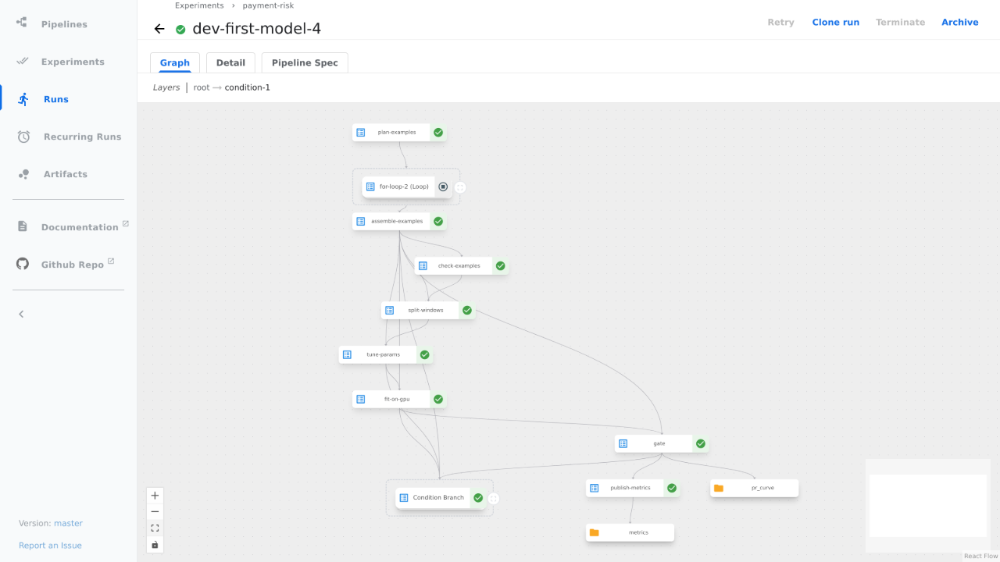
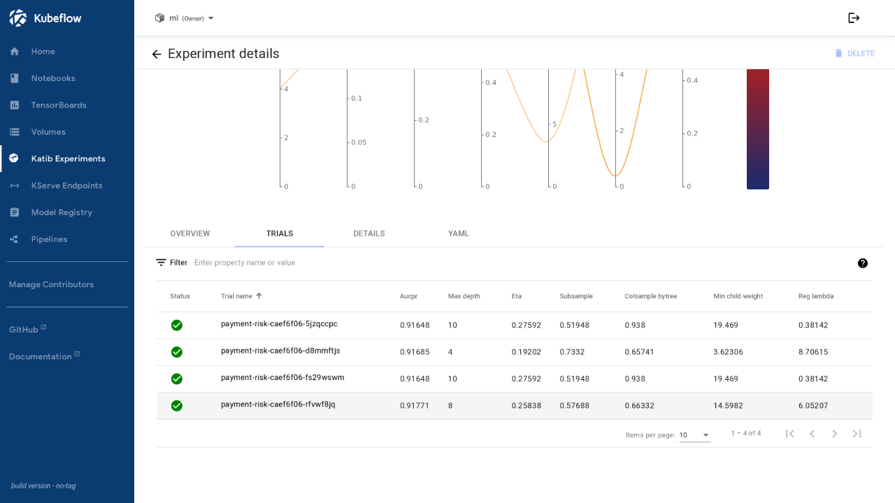

# Pipeline

**Status: dev runs done.** Three Kubeflow pipelines, all compiled from Git by `src/ml/pipelines/compile_pipelines.py` into the chart's `files/{dev,prod}` and deployed as a `Pipeline` and `PipelineVersion`. Dev runs the same chart as prod, compiled without node selectors and with smaller Spark sizes; the platform's `xgboost-gpu-distributed` runtime selects the local GPU there. Screenshots come from `kubeflow-dev.phuchoang.sbs`.

| Pipeline | Does | Started by |
|---|---|---|
| `payment-risk-training` | Builds the training set, fits, gates, registers and rolls out a version | The [drift](drift.md) check, or a manual run |
| `payment-risk-rollout` | Serves any earlier gated version, for rollback | A manual run |
| `payment-risk-promote` | Moves a challenger from 0 to a bounded share of traffic, gated by analysis ([serving](serving.md#ab-experiment)) | A manual run |

## Training pipeline

Every step runs `python -m risk_model.steps <step>` in the `ml` image, so the [notebook](../../src/ml/notebooks/payment_risk_exploration.ipynb) calls the same functions.

| Step | Does |
|---|---|
| `plan_windows` | Rolling windows from the run's start time, and the skip when there is no new data; every step below runs only when it says so |
| `plan_examples`, `stage_examples`, `assemble_examples` | Plan the chunks and fence the source tables, stage each chunk in parallel, then merge into a new training-set version; a given `training_set_snapshot` skips all three |
| `check_examples` | Missing or mistyped columns, duplicate keys, null labels, per-day fraud rate bounds; writes the null share per feature and day |
| `split_windows` | Window checks, counts and sample fraud rate per split |
| `tune_params` | Optional (`tune_trials` above 0). A Katib experiment: `tpe`, 8 trials, 2 in parallel, each a single-GPU TrainJob printing validation PR-AUC on a 5% negative sample, reading the pinned snapshot read-only |
| `fit_on_gpu` | A Trainer `TrainJob` on the chart's `payment-risk-xgboost` runtime with one node, which holds the shared GPU claim. It trains XGBoost on `device=cuda` over rows sorted by key and early-stops on validation `aucpr`, then the depth-1 additive baseline the gate compares against; it never falls back to CPU |
| `gate` | A GPU `TrainJob` scores the new model, the additive baseline and the current production version; thresholds from validation, metrics on test; KFP metrics and a PR-curve artifact. The step only launches the job and reads its report |
| `record_version` | Registers a passing model |
| `roll_out` | Serves the registered version, see [serving](serving.md) |

Run `caef6f06` completed all 26 steps in 19 min 16 s, registered `v2` and rolled it out.

Katib ran four trials, two at a time, in 1 min 52 s. Each trial is a single-GPU TrainJob that prints validation PR-AUC on the 5% negative sample, and `rfvwf8jq` was selected:

- **Decision thresholds** come from validation: decline where 0.1% of legitimate payments are flagged, step-up at 1%.
- **Gate:** the model must beat the baseline's test PR-AUC. With a production version it must also gain 0.005 PR-AUC without a lower recall at 1% FPR, a margin above the spread between retrains on the same data. A manual run can lower it with `gate_margin`, which dev uses to register a retrain that only matches production; the drift check never sets it.
- **Single GPU.** The trainer uses one L4 and no collective, so NCCL is not involved. Distributed training and a model-inside-image deployment are not used.
- **Registry.** A passing model is a new version of `payment-risk` in the Kubeflow Model Registry. The artifact URI is the model directory; the properties hold hyperparameters, test metrics, thresholds, ordered feature list, feature service, training-set snapshot and the source snapshot IDs, windows, cutoff, GPU and library versions, and the pipeline run. The stage (`production`, `challenger` or `archived`) is a property; a replaced version is also set to the native `ARCHIVED` state.
- **Run files** are written to `s3://<bucket>/runs/payment-gateway/ml/<run-id>/`.
- All scoring runs on the GPU. Notebooks cannot take GPU claims, so the notebook submits the same kind of TrainJob (`steps.fit_on_gpu`, `steps.gate`, `steps.experiments`) and reads the results; it avoids GPU nodes so it cannot starve them. The baseline is a depth-1 XGBoost model, an additive model stronger than the earlier logistic regression, so the gate rejects more candidates.

No Kubeflow recurring run starts training: the hourly drift check starts a run when the served features drift, or when the serving version was registered more than 14 days ago ([drift](drift.md)). The first step, `plan_windows`, stops the run when its cutoff is not later than the cutoff of the highest registered version, so a check that fires without new replayed history costs one small pod. On dev the windows are 36, 9 and 9 days, because 2026-09-02 to 2026-10-27 is replayed.
