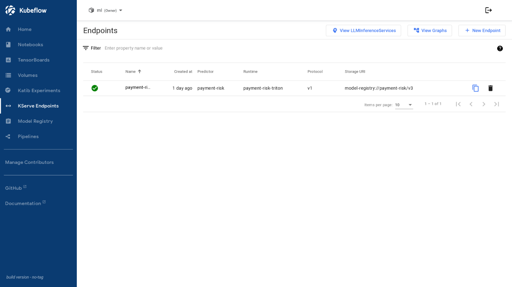
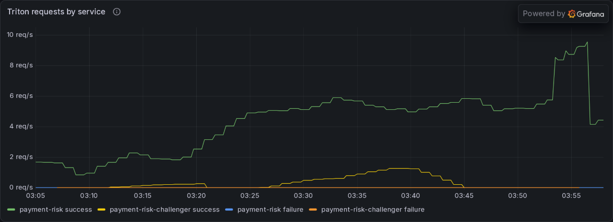
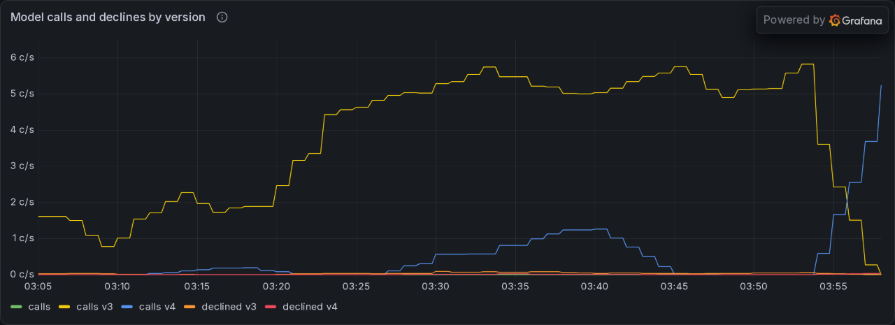

# Serving

Go Fraud owns the decision. It validates the attempt, applies the versioned rules policy, retrieves features from the Feast feature server, and, where a model endpoint is configured, calls the Triton model server directly with the features and applies policy to the score. There is no Python coordinator between Go, Feast and Triton. Code: [`src/payment-gateway/fraud`](../../src/payment-gateway/fraud).

The read-only [risk agent tool](../llm/agents.md#risk-agent) uses the same online features and binary inference protocol for what-if re-scoring.

## Today

- Rules decide, and the model can add a decline. Where the online store is enabled, Go Fraud reads the features and calls the model. A score at or above `FRAUD_MODEL_THRESHOLD` adds a decline (reason `MODEL_RISK_HIGH`, policy `rules-v1+model`), but only when the predictor answered and all five feature views were available; otherwise the rules decision stands. The score never approves what the rules decline. The feature read has a 250 ms deadline and the model call its own 150 ms, both inside the 1 s assessment deadline, and a predictor failure is recorded as `timeout` or `error`.
- Dev and prod run the same configuration: the decline threshold (0.1% FPR on validation) of the served version is packaged into its Triton config and read by Go Fraud, with 0.512 in the chart as the fallback for a version whose config has none. Where the stream views have no fresh rows the rules decision stands, and the evidence records why.
- Payments records the decision before any processor effect; fraud errors fail closed.

## Model service

The `payment-risk` InferenceService runs NVIDIA Triton with the FIL backend on the GPU; nothing scores on a CPU. The chart owns the `ServingRuntime` (the pinned Triton image and the shared GPU claim, by name); the platform places the pod on the GPU node and adds its toleration; the `roll_out` step creates and patches the service, and Argo CD does not own it. It is a Standard-mode Deployment with one replica and is cluster-local.

- **GPU sharing.** Triton, the fit and Katib TrainJobs, and the gate and experiment jobs all reference the chart's one `ResourceClaim` (`ml-gpu`), so they run together on the ML GPU (dev GTX 1650, prod L4). The dev claim selects the GTX 1650 by its DRA product name; the RTX 5060 Ti is reserved for the separate LLM claim. The chart's `TrainingRuntime` carries the claim, because a TrainJob cannot patch `resourceClaims`. The instance group is `KIND_GPU`, never `KIND_AUTO`, which would fall back to the CPU; without a GPU the predictor stays Pending and the fraud service records `timeout` or `error`.
- **Model loading.** `roll_out` sets the storage URI to `model-registry://payment-risk/<version>`. KServe resolves the registry version to the model directory in object storage and mounts it at `/mnt/models`. `record_version` writes the repository entry there: `payment-risk/config.pbtxt` and `payment-risk/<N>/xgboost.json`, where `N` is the version's number, so every answer names the version that made it. The config carries the ordered feature list and the registry version as parameters.
- **Request:** Open Inference Protocol v2, `POST /v2/models/payment-risk/infer`, with one FP32 row in the packaged feature order sent as binary tensor data (`Inference-Header-Content-Length`). A missing feature or an unavailable view is NaN, which XGBoost treats as missing and JSON cannot carry. Go reads the order, the decline threshold and the bin edges of each version from `GET /v2/models/payment-risk/config` and keeps them per version.
- **Response:** the fraud class's probability is the second of two FP32 values, and `model_version` is the version number. If that number differs from the version the cached order belongs to, Go discards the score and reads the order again on the next call, so a rollout never scores a row laid out for another version.
- **Check against CPU XGBoost.** On dev, 215 real rows with 9% missing values scored within 6e-8 of CPU XGBoost, and all-missing and half-missing rows matched its default directions. A single-row call took 1.2 ms median and 4.7 ms at p99 over loopback.
- **Image.** Triton `26.10-py3` pinned by digest. It runs on the dev driver through CUDA forward compatibility. The node pulls from `nvcr.io`, whose DNS answers are occasionally stale on the dev LAN; a failed pull is retried with `talosctl image pull`.
- **Rubric gap.** The model is not baked into the image. A model image needs a registry write credential or a platform-run registry; the version stays traceable through the Model Registry instead.

On 2026-11-04, after recreating the unallocated dev claim with its selector, `ml-gpu` allocated `gpu-1` (GTX 1650 UUID `GPU-f5a79fce-f9b1-1881-6037-6502c34eccf7`). The predictor became Ready with zero restarts; FIL loaded version 4, and `nvidia-smi` inside the predictor reported 128 MiB used out of 4096 MiB. The isolated `payment-risk-fit-gtx1650-20261104` TrainJob also completed with exit code 0 on the same claim: its container ran from 08:02:25 to 08:02:51 UTC while the predictor remained Ready. Scoring through the risk MCP remains pending verification.

## Deploy and rollback

`roll_out` is the last step of `payment-risk-training` for a passing model. It patches the storage URI, waits until the Deployment has rolled out the new storage URI, sends an all-missing row and fails unless Triton answers with a probability from the new version, then marks the version `production` and the previous one `archived`. If the check fails, it patches the previous version back. The `payment-risk-rollout` pipeline reruns the step for any earlier version that passed its gate, for rollback.

On dev, `payment-risk-rollout` with `version=v1` served the earlier version again in 1 min 47 s (3 of 3 steps), and the next training run rolled `v3` out in 20 min 30 s. A binary request for `v2` with all 50 features missing, and one with only `amount_minor` and `has_device` set, both returned `model_version` 2 and a probability of 0.8937. The Kubeflow endpoints page shows the service ready on the `payment-risk-triton` runtime with the registry URI of the live version; the model's registry entry is on [training](training.md#versions).

## Autoscaling and dashboard

KServe's KEDA autoscaler class turns the predictor's `autoScaling` section into a ScaledObject, so the chart's `serving.predictor` values set the range (1 to 2 replicas) and the trigger. `roll_out` puts the class annotation on a new service and adds it to an existing one when it replaces the predictor. The trigger reads Triton's own metrics (scraped from port 8002 by a `VMPodScrape`) from the platform's VictoriaMetrics: the mean time a request waits in the queue, `rate(nv_inference_queue_duration_us) / rate(nv_inference_request_success)`, with KEDA asking for one replica per 5 ms of it. A request queues only when the GPU is busy, so the metric rises with load and not with idle time, and a zero-traffic window reads 0. Every replica uses the shared `ml-gpu` claim, so extra replicas add Triton's host-side concurrency on the same GPU rather than a second GPU; the L4 node's single GPU is the ceiling. Scale-down waits 5 minutes (KEDA's default stabilisation).

On dev a throwaway service with the chart's runtime and predictor values, and the target lowered to 20 µs so the demo needs no overload, scaled from 1 to 2 replicas about 80 seconds after 24 concurrent clients started sending up to 175 requests per second, and the second pod ran on the same GPU claim. With the target back at 5 ms the service returned to 1 replica about 5 minutes later. The mean queue time was 0.30 ms and the compute time 0.20 ms, well below the 5 ms target the chart sets, so real traffic of this size would not scale. The 5 ms target is untuned until prod traffic exists.

The ML serving dashboard (`ml-serving` in the ML folder of the platform Grafana) shows Triton's request rate, queue and compute time per request, predictor replicas, GPU utilization, and the fraud service's `fraud.model.calls` by status and enforcement. The Grafana sidecar only watches a fixed list of namespaces, so the chart creates the dashboard ConfigMap in `observability`, which the Argo CD project allows for that reason.

## A/B experiment

A gate-passed version can run as a challenger next to the champion, and traffic moves to it in bounded steps that an analysis must approve.

- **Challenger service.** `roll_out` with `role=challenger` serves the version as the InferenceService `payment-risk-challenger` on the same runtime, GPU claim and KEDA scaling, and the registry marks it `challenger`.
- **Split.** An Istio waypoint in `ml` and a Gateway API route split the champion's Service between the two services, 100/0 until the `payment-risk-promote` pipeline changes the weights. Only that pipeline changes them, never above 20 percent, and Argo CD ignores them as it does for Edge. The split is random per request, and `roll_out` labels the champion Service for the waypoint.
- **Analysis.** Each step runs an Argo Rollouts `AnalysisRun` built from the `payment-risk-challenger` template, over a 10 minute window on the chart's values and 5 minutes on dev. It needs a minimum number of challenger requests, a failure rate of at most 1%, a queue plus compute time per request of at most twice the champion's, and a decline share within 2 percentage points of the champion's (a ratio of two shares near 0.3% is noise at these volumes).
- **Outcome.** A failed analysis returns the weights to 0, deletes the challenger and archives its version. After the last step the challenger is deleted, then the champion service is updated to its version and probed, so the single GPU node never holds three model servers; a failed probe redeploys the old version.
- **Scoring.** Go Fraud scores each answer under the layout and threshold of the version that produced it, and `fraud.model.calls` carries `model_version` and `declined`.

On dev, v4 (the same data and settings as v3, registered by a manual run with a lowered `gate_margin`, so the two score identically) ran as the challenger next to v3 under about 4 payments per second from the live simulator. Three `payment-risk-promote` runs, in order:

| Run | Steps | Result |
|---|---|---|
| `dev-promote-v4-b` | 10, 20 | Aborted at 10%: the decline ratio was 3.7 on 1 decline in 94 calls. Weights back to 0, challenger deleted, v4 archived. The check became the difference in decline share |
| `dev-promote-v4-c` | 10, 20 | Aborted at 10%: 46 to 57 challenger requests against a minimum of 50, because the simulator then sent 1.7 payments per second. Same cleanup |
| `dev-promote-v4-d` | 10, 20 | Both steps passed and v4 replaced v3 as production; v3 is `archived` |

| Step | Challenger calls | Decline share, challenger / champion | Queue plus compute per request, challenger / champion |
|---|---:|---|---|
| 10% | 171 of 1,834 | 1.17% / 1.20% | 381 µs / 376 µs |
| 20% | 370 of 1,873 | 1.08% / 1.00% | 416 µs / 418 µs |

Between the runs, the swap itself found a limit: with the challenger, the old champion and the new champion's surge pod on the one GPU node, the new pod sat Pending on CPU for 11 minutes until the challenger was deleted by hand, which is why the step now deletes it first. The Service kept its waypoint label through the swap, and the KEDA scaler stayed in place.

Tried and dropped on dev, 2026-11-03: KServe's Knative canary (Knative Serving 1.23.0 and 1.24.0 reject DRA `resourceClaims`) and its InferenceGraph (the router discards response headers, so binary answers fail). A waypoint route split 400 binary requests 309 to 91 at 80/20, at +2.4 ms median and +9.8 ms p99. Not verified: the platform's seccomp policy for the waypoint pod runs on dev and is applied to prod, but no waypoint has been created on prod.

## Planned

| Capability | Plan |
|---|---|
| Feature-retrieval API | Typed, validated lookups by customer and method ID with health checks, deployed by Helm with rolling update and automatic rollback |
| Autoscaling of the retrieval API | Request-driven autoscaling for the Feast retrieval API; inference scales as above |
| A/B traffic on the retrieval API | Not planned beyond the model experiment above |
| Load test | Locust run against the retrieval API, recording throughput, latency percentiles and errors as an HTML report |

Every decision records the policy, model and feature versions it used. The model call never triggers payment effects; only the decision does.
