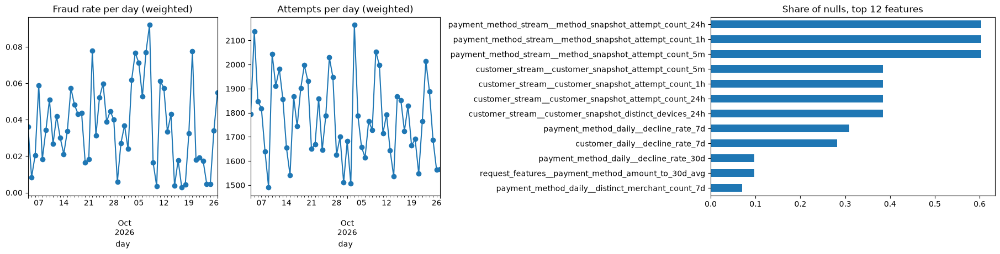
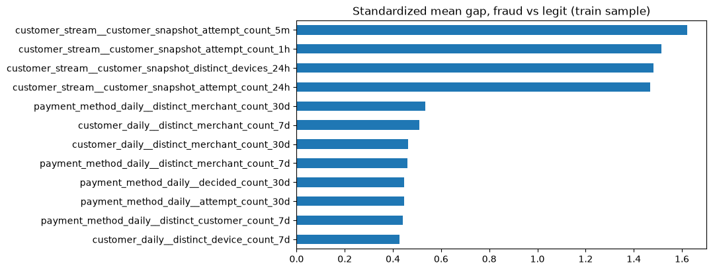
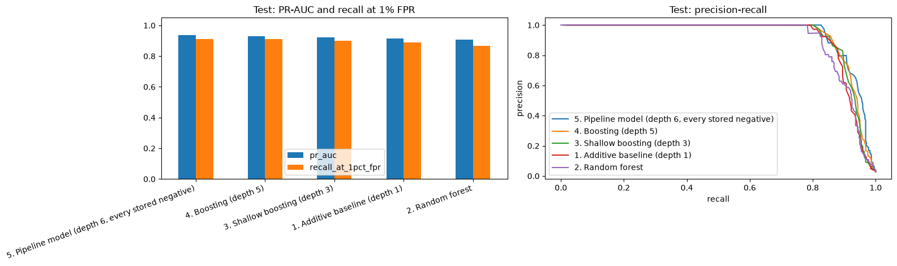
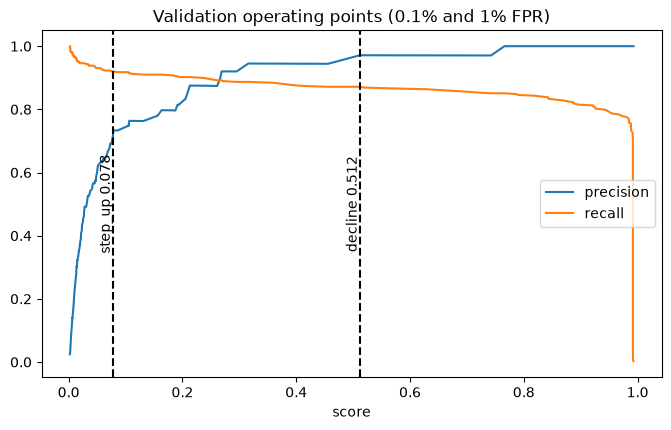
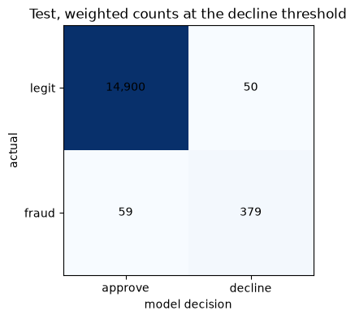
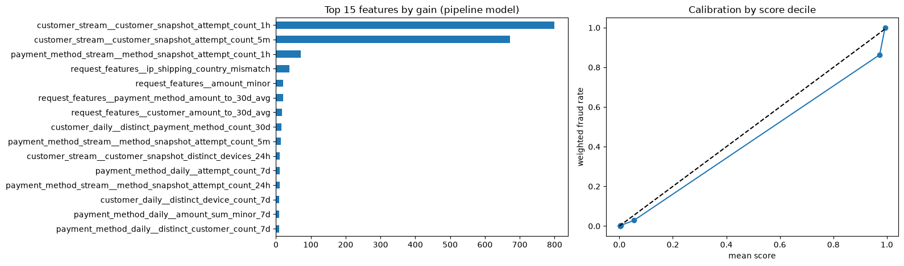
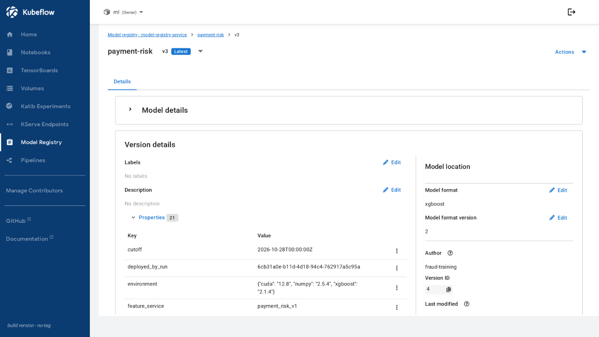

# Training

**Status: dev runs done.** Code: [`src/ml`](../../src/ml); chart: [`infra/charts/ml-training`](../../infra/charts/ml-training). The pipeline that runs this is on [pipeline](pipeline.md), the retraining trigger on [drift](drift.md), the served model on [serving](serving.md).

Everything measured below ran on dev (RTX 5060 Ti of `dev-server1`) against training-set snapshot `7781420152380000469`: the replayed history 2026-09-02 to 2026-10-27 at a 10% negative sample.

## Training data

- One row is one scored payment attempt. The rows, labels and request fields come from `fraud_feast.training.entity_rows`, and the features from `get_historical_features` over the `payment_risk_v1` feature service ([feature store](feature-store.md)). Training code computes no feature, label or entity.
- The target is simulation truth (`is_fraud`), treated as real for this project and available at the attempt time, so the splits need no maturity gaps. A real deployment would see delayed, partial chargebacks, and its metrics would be lower.
- The dataset step runs Feast in local Spark inside one pipeline pod, in 4-day chunks on prod and 16-day chunks on dev, at most four at a time on prod and one on dev, one day of entity rows per Feast call. Each day is appended to staging before the next is read; a retry clears and rebuilds its chunk. The completed chunks are merged into the examples table in one commit. Prod staging and assembly use a 6 GiB JVM heap inside a 10 GB pod to fit the 16 GiB Spot workers and leave room for Python and Arrow. It keeps every positive and the negatives whose stable hash bucket of the attempt key is below 100 of 1000, stores the bucket on the row, and weights negatives by the inverse rate.
- Output is one Iceberg v2 merge-on-read table, `lake.ml.payment_risk_v1_examples`. Each run is one `MERGE` that stores only inserted and deleted rows, so every version is readable by its snapshot ID. The snapshot records the snapshot IDs of `label_attempt`, `silver.attempts`, `silver.payment_events`, the daily tables and the stream tables, the window, the cutoff, the sampling rate, the feature service and its ordered feature list. A build fails if any of those tables moved while it ran, or if the stream history does not cover the window.
- Class imbalance makes accuracy alone unsuitable; report precision, recall and PR-AUC.

## Windows

| Window | Range |
|---|---|
| train | 2026-07-29..2026-09-30 |
| validation | 2026-10-01..2026-10-14 |
| test | 2026-10-15..2026-10-28 |

These are the windows for a first run on a full replay. A later run rolls them: contiguous test, validation and train windows of 14, 14 and 56 days ending on the start date minus one day, or on the latest earlier day for which every day of the three windows has rows in the stream tables (`risk_model.windows.rolling`, `latest_covered`), so a gap between replayed and live history is never spanned. Passing all four of `train`, `validation`, `test` and `cutoff` overrides the rule. `WindowSplitter` rejects overlapping, gapped or misordered windows, and rows outside every window.

## Notebook

[`payment_risk_exploration.ipynb`](../../src/ml/notebooks/payment_risk_exploration.ipynb) is committed without outputs. It was executed top to bottom with `jupyter nbconvert --execute` in a one-off Job, because the Notebook server avoids GPU nodes while its volume sits on one, and the figures below are that execution's outputs, saved as PNG. Its fits and scores run in GPU TrainJobs (`steps.fit_on_gpu`, `steps.gate`, `steps.experiments`) while Triton holds the same GPU. Environment overrides: `NOTEBOOK_END_DAY`, `NOTEBOOK_TRAIN_DAYS`, `NOTEBOOK_VALIDATION_DAYS`, `NOTEBOOK_TEST_DAYS`, `NOTEBOOK_COMPARE_RATE`, `NOTEBOOK_ABLATION_RATE`, `NOTEBOOK_FOLDS` and `NOTEBOOK_SNAPSHOT`; an unset snapshot builds a new dataset version.

**Split.** Training 2026-09-04..2026-10-09, validation 2026-10-10..2026-10-18, test 2026-10-19..2026-10-27 (36, 9 and 9 days from `windows.rolling`, cutoff 2026-10-28).

| Split | Rows | Positives | Weighted fraud rate |
|---|---:|---:|---:|
| train | 8,863 | 2,676 | 4.1% |
| validation | 1,946 | 389 | 2.4% |
| test | 1,933 | 438 | 2.8% |

Fraud arrives in bursts, with 5 to 159 positives per day. Stream features are null for 51% of legitimate and 9% of fraudulent attempts, so a missing stream snapshot is itself a signal. The features that separate fraud from legitimate attempts most are the customer's 5-minute to 24-hour attempt counts and distinct devices:

**Which features earn their place.** Each candidate is scored walk-forward over the last 14 days (training on the earlier days, three seeds, 378 fits in one job). The table gives the change in mean PR-AUC against all features when the feature or view is removed, the days (of 14) the set was worse and better, and the worst day:

| Removed | Change in PR-AUC | Days worse / better | Worst day |
|---|---:|---:|---:|
| view `request_features` | -0.2139 | 14 / 0 | -0.6618 |
| view `customer_stream` | -0.0405 | 7 / 7 | -0.2288 |
| `customer_amount_to_30d_avg` | -0.0181 | 10 / 4 | -0.1188 |
| view `payment_method_stream` | -0.0099 | 10 / 4 | -0.0432 |
| `scored_hour_utc` | +0.0046 | 5 / 7 | -0.0053 |
| view `payment_method_daily` | +0.0158 | 5 / 9 | -0.0031 |
| `payment_method_amount_to_30d_avg` | +0.0159 | 5 / 9 | -0.0634 |
| view `customer_daily` | +0.0190 | 6 / 8 | -0.0258 |

Only the first four hurt consistently when removed. The four that help on average win on 7 to 9 of 14 days, which is not a decisive split, so the evidence supports neither dropping nor adding them, and the feature service is unchanged. `request_features__item_count` is 1 on all rows because the simulator builds every order from one purchase.

**Five models, simple to strong.** All train and score on the GPU, from the depth-1 additive baseline the gate uses to the pipeline's own settings. On the test window, with thresholds from validation:

| Model | PR-AUC | Recall at 1% FPR | Recall in top 5% |
|---|---:|---:|---:|
| Pipeline model (depth 6, every stored negative) | 0.9370 | 0.9110 | 0.9498 |
| Boosting, depth 5 | 0.9294 | 0.9110 | 0.9384 |
| Boosting, depth 3 | 0.9231 | 0.8995 | 0.9315 |
| Additive baseline, depth 1 | 0.9156 | 0.8881 | 0.9155 |
| Random forest | 0.9073 | 0.8676 | 0.9224 |

**Thresholds and test.** The decline threshold is 0.512 (0.1% of legitimate attempts declined on validation) and step-up is 0.078 (1%). Applied unchanged to the test window, the pipeline model declines 379 of 438 weighted frauds and 50 of 14,950 legitimate attempts, and reviewing the top 5% of scores catches 95% of fraud, 19.0 times a random review.

The pipeline's fit took 4.0 s and stopped at round 45. The notebook's last cell runs `steps.gate` against production, which by then was this same model, so it reports "did not pass": the gate requires a 0.005 PR-AUC margin over production. Saving writes `model.json` and `baseline.json` to the run directory.

## Versions

| Version | Settings | Test PR-AUC | ROC-AUC | Recall at 1% FPR | Precision at decline | Decline / step-up threshold |
|---|---|---:|---:|---:|---:|---|
| `v2` | tuned | 0.9235 | 0.9836 | 0.8904 | 0.9494 | 0.5607 / 0.1169 |
| `v3` | defaults | 0.9370 | 0.9895 | 0.9110 | 0.8834 | 0.5122 / 0.0783 |
| `v4` | defaults, same data, with the [drift](drift.md) reference profile | 0.9370 | 0.9895 | 0.9110 | 0.8834 | 0.5122 / 0.0783 |

Four trials did not beat the defaults, so `v3` was gated against `v2` and replaced it. `v4` retrains `v3`'s data and settings for the reference profile and scores the same, so a manual run registered it with a lowered `gate_margin`; it replaced `v3` through the [A/B promotion](serving.md#ab-experiment). `v2` is `ARCHIVED`; the first version was archived too and its model files deleted, because the registry has no delete call. The registry UI hides archived versions.

Every version records its data version: the training-set snapshot (`7781420152380000469` for `v2` and `v3`), the snapshot IDs of the daily, stream, label, attempt and payment-event tables, the windows, the cutoff, the feature service and the ordered feature list. The training set is one Iceberg table with one `MERGE` per run, so each version reads back by snapshot ID. The second run reused the snapshot: a run without one waited 16 minutes for the 8 GB staging pod, which the two small dev workers could not place (dev-server3 had about 6.8 GiB of memory requests free), and was terminated. An incremental rebuild is task 7.8.

## Code

The five key classes, each with its own tests in [`src/ml/tests`](../../src/ml/tests):

| Class | Module | Role |
|---|---|---|
| `WindowSplitter` | `split.py` | Holds the train, validation and test windows and selects rows by time; rejects overlap, gaps and rows outside every window |
| `DatasetReader` | `data.py` | Reads one snapshot of the training-set table: sample rate, provenance, validation and weighted numpy `Split`s |
| `RiskTrainer` | `train.py` | GPU XGBoost fit with early stopping, the depth-1 baseline, scoring |
| `GateEvaluator` | `evaluate.py` | Thresholds from validation, test metrics, the pass or fail verdict |
| `RegistryClient` | `registry.py` | Versions, properties, registration, the passed-gate check and promotion in the Model Registry |

Property-based tests (Hypothesis): rolling windows are contiguous, sized and end on the end day, and shift by the same days when the end day moves (`test_windows.py`); the same rows in any order train the same model (`test_train.py`).
