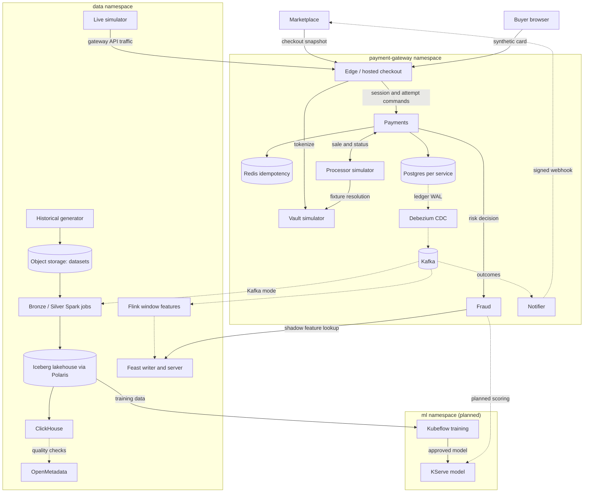

# Platform architecture

The system has three layers on one shared Kubernetes platform: the payment gateway that produces authoritative payment events, a data platform that turns them into curated tables and features, and an ML platform that trains and serves the fraud model. An LLM agent layer reads from both. The domain and the AI problem are in the [proposal](proposal.md); the build order and status are in the [roadmap](roadmap.md).

The shared platform (Talos clusters, Argo CD, operators, the ClickHouse operator, OpenMetadata, Kubeflow, observability) is owned by [talos-proxmox](https://github.com/phuchoang2603/talos-proxmox/tree/main/docs/architecture). This repository owns the application workloads, their charts (including the Polaris catalog), contracts and pipelines. See [infrastructure](../deployment/infra.md).

## Deployable units

| Unit | Role | Owned state | Status |
|---|---|---|---|
| Edge / hosted checkout | Go; integration authentication, merchant API, browser checkout | Bounded checkout access | Deployed |
| Vault simulator | Go; synthetic tokenization, processor-only fixture resolution | Token mappings, encrypted fixtures | Deployed |
| Payments | Go; sessions, attempts, versioned commands, recovery | Versioned rows, append-only ledger, idempotency, effect intents | Deployed |
| Processor simulator | Go; simulated sales with configurable latency and lost responses | Operation results | Deployed |
| Notifier | Go; signed, deduplicated webhooks with retries | Inbox, deliveries, retry state | Deployed |
| Fraud | Go; validates inputs, applies the rules policy, retrieves features in shadow mode | Policy and decision metadata, assessments | Deployed |
| Kafka, Debezium, Karapace | Outbox CDC, internal event transport, schema registry | Topics, registered schemas | Deployed |
| Historical generator | Python; per-day synthetic history to object storage | Immutable datasets v18 (dev), v19 (prod) | Deployed |
| Live simulator | Python; current-time gateway traffic and labels | None | Deployed, disabled |
| Bronze and Silver pipelines (DP1, DP2) | Spark on the Spark Operator, ClickHouse checks, OpenMetadata | Iceberg tables, run reports | In progress |
| Flink streaming features, Feast writer and server | Python; window features to the online store | Checkpoints, Feast Redis | Deployed in dev (shadow) |
| Offline features (DP3), training, KServe, drift | Spark, Kubeflow, KServe | Feature tables, models | Planned |
| Fraud investigation agent | LLM agent over recorded evidence | Audited retrievals | Planned |

## Deployment view

Solid arrows are synchronous calls or storage writes; dotted arrows are asynchronous events.

Only Edge `/checkout/*` is publicly routed. Internal APIs are ClusterIP-only behind the Istio ambient mesh with service-account authorization; see [security](../deployment/security.md). The marketplace context is in the [marketplace gateway note](https://github.com/phuchoang2603/refurbished-marketplace/blob/main/docs/ecommerce-fraud-gateway.md).

## Where to read next

- Gateway: [architecture](../payment-gateway/architecture.md), [flows](../payment-gateway/flows.md), [conventions](../payment-gateway/conventions.md), [Docker images](../payment-gateway/docker.md).
- Data: [offline data](../data/offline.md), [online data](../data/online.md), [storage](../data/storage.md), [orchestration and governance](../data/orchestration-governance.md).
- ML: [feature store](../ml/feature-store.md), [training](../ml/training.md), [serving](../ml/serving.md).
- Deployment: [CI](../deployment/ci.md), [CD](../deployment/cd.md), [infrastructure](../deployment/infra.md), [security](../deployment/security.md), [observability](../deployment/observability.md).
