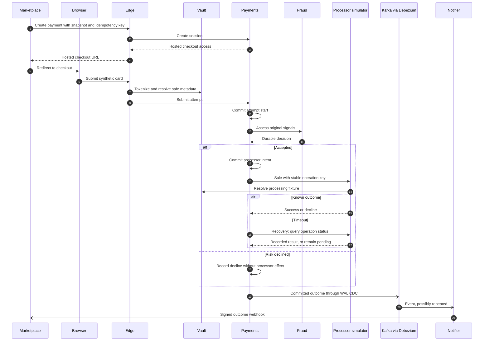

# Payment gateway

The gateway owns hosted checkout, payment attempts, fraud decisions, simulated processing and signed outcome webhooks. The marketplace owns orders, inventory and buyer authentication. All cards and processor responses are synthetic.

## Gateway design

| Service | Responsibility | Owned state |
|---|---|---|
| Edge | Integration authentication, hosted checkout, tokenization and API translation | Checkout access; no payment database |
| Payments | Payment/attempt lifecycle, idempotency and recovery | Postgres state, append-only event ledger and Redis idempotency |
| Fraud | Rules, durable assessments, Feast lookups and model scoring | Assessment database and evidence |
| Vault simulator | Allow-listed fictional cards, opaque tokens and restricted resolution | Encrypted fixtures and token mappings |
| Processor simulator | Idempotent simulated sales and operation-status lookup | Operation results |
| Notifier | Kafka consumption and signed webhook retries | Inbox and delivery state |

Each service owns its database and migrations where needed. Internal calls use versioned gRPC contracts; Edge translates HTTP requests. Fraud reads Feast/Redis features and scores them with the Triton model; rules decide first, and a score at or above the threshold can add a decline when every feature view is available ([serving](../ml/serving.md)).

## Checkout flow

1. The marketplace creates a payment with an integration API key, an idempotency key and an immutable order snapshot. Payments derives merchant/customer UUIDv5 identities from integration-scoped external IDs and returns hosted checkout access.
2. The browser opens checkout. Edge exchanges the URL token for a secure HTTP-only cookie and tokenizes an allow-listed fictional card through Vault.
3. Edge validates token ownership, resolves safe method metadata and submits an attempt. Payments commits its start and original signals before requesting Fraud assessment.
4. Fraud records a durable decision. A risk decline ends the attempt without calling the processor; an accepted assessment permits Payments to commit a processor intent.
5. The processor simulator resolves the fictional fixture through its restricted Vault port and executes with a stable operation key. Payments commits the known outcome or retains a pending operation for recovery.
6. Debezium publishes committed ledger bytes to Kafka. Notifier deduplicates event IDs and delivers signed outcomes. The marketplace uses webhooks or an authenticated status query to update commerce state; a browser redirect alone does not prove success.

## API and access

[HTTP handlers](../../src/payment-gateway/edge/internal/transport) implement the API; [protobuf contracts](../../contracts/payments/v1) define internal requests and events.

| Operation | Authentication and behavior |
|---|---|
| Create/read payment: `/v1/payments` | Integration bearer key; creation requires `Idempotency-Key` and a validated HTTPS return URL |
| Submit attempt: `/v1/checkout/sessions/{session_id}/attempts` | Session-bound checkout token and idempotency key; returns succeeded, declined or pending |
| Hosted checkout: `/checkout/` | Browser cookie, cross-site request protection and one key retained across form resubmission |
| Synthetic tokenization: `/v1/payment-methods` | Synthetic integration only; rejects cards outside the fictional allow-list |

Vault exposes metadata to Edge and fixture resolution only to the processor. Tokens and card data stay out of events, Fraud inputs, Redis and analytics.

## Routing and gateway

The public checkout path uses Cloudflare Tunnel and an Istio Gateway API route; internal calls use the ambient service mesh. [Domains, HTTPS, gateways and the service mesh](../deployment/networking.md) owns hostname configuration, TLS boundaries, routing, identities and verification. [Delivery](../deployment/cd.md#edge-progressive-delivery) owns stable/canary rollout behavior.

## Consistency and recovery

Payments updates versioned state, one ledger event and durable idempotency state atomically. Redis claims request-bound keys first, with a 50 ms deadline and 24-hour TTL; Postgres uniqueness remains authoritative during cache misses or outages. Reusing a key with different content conflicts.

Fraud timeout/unavailability leaves the attempt pending with an assessment error, never a risk decline or processor effect. Recovery reuses the original signals and fenced assessment identity. Defaults are a five-second attempt budget, one second for Fraud, three seconds for the processor, and a five-minute assessment retry horizon bounded by payment expiry.

A processor timeout means an unknown outcome. Recovery queries by the original operation key before repeating a request. Late assessments cannot authorize expired payments; expiry waits for unresolved processor effects.

Notifier consumes `payments.events.v1`, deduplicates by event ID and retries signed `attempt.declined`, `payment.succeeded` and `payment.expired` deliveries. Receivers validate the HMAC-SHA256 signature and timestamp and deduplicate event IDs. Kafka or webhook outages do not block payment commits.

[Prod acceptance on 2026-10-23](../../openspec/changes/archive/2026-10-23-build-minimum-payment-gateway/verification.md) exercised tokenization, approvals/declines, timeout recovery, signed webhooks, Redis fallback and CDC outage catch-up. That record predates the GCP migration.

The domain boundary is summarized on the [overview](../Home.md#domain).
